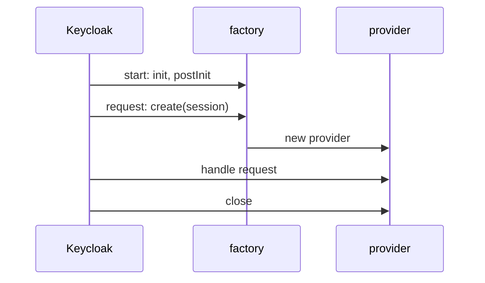

# What A Service Provider Interface Is

Before you write your own provider, it helps to see that Keycloak is already made of them. The way Keycloak hashes passwords, writes events to its log and answers the OpenID Connect endpoints are all providers of some SPI. This part looks at the SPIs a running Keycloak has, and then explains the three objects every provider works with: the factory, the provider and the session.

## Every feature is a provider of an SPI

A Service Provider Interface (SPI) is a Java interface that Keycloak defines for one kind of extension. For example, the SPI `eventsListener` describes "something that receives events", and the SPI `authenticator` describes "one step of a sign-in". A provider is one implementation of an SPI. The SPI `eventsListener` has a provider called `jboss-logging`, which writes events to the server log, and you can add your own next to it.

Keycloak reports every SPI and every provider it loaded through the Admin REST API, at the path `serverinfo`. The Admin REST API is the HTTP API the Admin Console uses to manage Keycloak. The tool `kcadm.sh` calls it from the command line, and it ships inside the Keycloak image. The helper below runs `kcadm.sh` in the Keycloak pod and signs in as the lab-only administrator on every call, so it keeps working after Keycloak restarts. Paste it into your terminal:

<!-- astrona:playground:renew -->

```sh
NAMESPACE=spi-demo

# kcadm runs kcadm.sh inside the Keycloak pod. It signs in to the realm
# master as the lab-only administrator on every call, so it keeps working
# after Keycloak restarts.
kcadm() {
  kubectl -n "$NAMESPACE" exec -i deploy/keycloak -- bash -c '
    /opt/keycloak/bin/kcadm.sh config credentials --server http://localhost:8080 \
      --realm master --user admin --password admin --config /tmp/kcadm.config >/dev/null &&
    /opt/keycloak/bin/kcadm.sh "$@" --config /tmp/kcadm.config' kcadm "$@"
}
```

Now ask Keycloak how many SPIs it has. The server info is one large JSON document, so `jq` picks out the part you need:

```sh
kcadm get serverinfo | jq '.providers | keys | length'
```

The number is large, more than a hundred. Each key under `providers` is the name of one SPI. Look at the providers of two SPIs you will extend later in this course, the event listeners and the realm resource providers:

```sh
kcadm get serverinfo | jq '.providers["eventsListener"].providers | keys'
kcadm get serverinfo | jq '.providers["realm-restapi-extension"].providers | keys'
```

The first list contains `jboss-logging` and a few other built-in listeners. The second list holds the built-in realm resource providers. A realm resource provider is a provider of the SPI `realm-restapi-extension`; it adds an HTTP endpoint under `/realms/<realm>/<provider id>`. Neither list holds anything called `inventory-status` yet. Your provider will appear in the second list once Keycloak loads it.

> [!TIP]
> `kcadm get serverinfo` is the first command to run whenever a custom provider "does nothing". If the provider id is missing there, Keycloak never loaded it, and nothing in the realm settings can help.

## Factory, provider and session

Every SPI comes as a pair of interfaces: one for the provider and one for its factory. For the endpoint in this module they are `RealmResourceProvider` and `RealmResourceProviderFactory`. The two have different lives, and mixing them up causes many bugs.

The **provider factory** is created once, when Keycloak starts. Keycloak calls its `init()` method with the factory's configuration, then `postInit()` once every factory exists, and keeps the factory until it shuts down. The factory's `getId()` returns the provider id, the name you see in the server info. The **provider** is created by the factory's `create()` method, usually once per request, and closed with `close()` when the request ends.

The object that connects them is the `KeycloakSession`. Keycloak passes a `KeycloakSession` to `create()`. It gives the provider access to the current request, the current realm, the users, and every other provider. A provider keeps the session for one request; a factory never keeps a session, because a session lives only as long as its request.



The diagram shows the two lives: Keycloak sets up the factory once at start, then asks it for a fresh provider for each request and closes that provider when the request ends.

## How Keycloak finds a factory

Keycloak does not scan your JAR for classes. It uses Java's `ServiceLoader`, which reads text files in the JAR under `META-INF/services/`. Each file is named after a factory interface, and each line in it is the full class name of one factory. For the endpoint in this module the file is `META-INF/services/org.keycloak.services.resource.RealmResourceProviderFactory`, and its one line names your factory class.

This design explains the two mistakes you will meet most often. If the file has the wrong name, `ServiceLoader` never opens it, so Keycloak never sees the factory and logs nothing at all. If the file has the right name but lists a class that does not exist, `ServiceLoader` fails while Keycloak starts, and the server does not start.

One more fact matters before you write code. Most SPIs, including the three this course uses for Java code, are internal Keycloak APIs. Keycloak can change them in any release without notice, so a provider is built against one Keycloak version and tested again on every upgrade.

You now know that Keycloak is made of providers of SPIs, how to list them, and how a factory, a provider and a session work together. The open question is what the code for one provider looks like, and how it gets into a JAR that Keycloak can load.

## Common pitfalls

> [!WARNING]
> - **Keeping a `KeycloakSession` in a factory.** A session belongs to one request. Keep it in the provider, which lives for that request only.
> - **Expecting Keycloak to find classes by scanning the JAR.** It finds a factory only through the file in `META-INF/services`.
> - **Confusing the SPI name with the provider id.** `realm-restapi-extension` is the SPI; `inventory-status` will be the provider id.
> - **Treating an internal SPI as a stable API.** Build against the exact Keycloak version you run, and test again on every upgrade.
