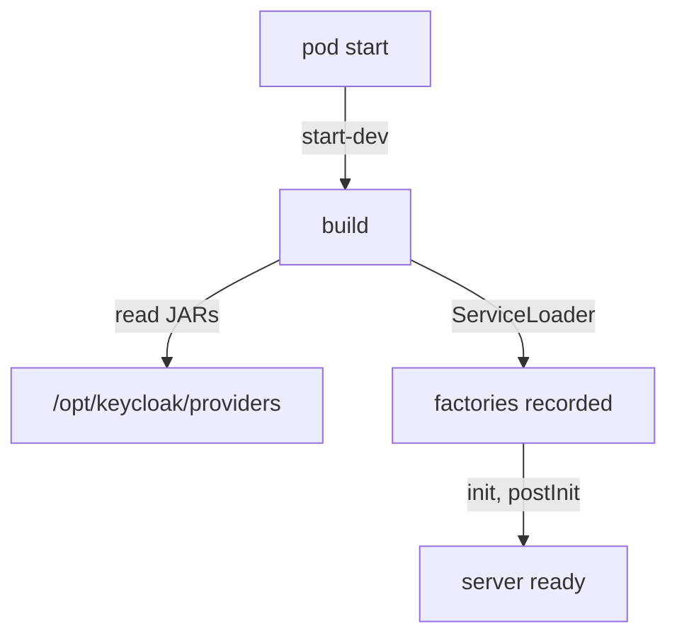

# Loading Providers Into Keycloak

A JAR in the providers directory is not yet a provider in Keycloak. Keycloak reads that directory only when it builds itself, and it builds itself only at start. This part proves that Keycloak loaded the `inventory-status` provider, explains the build step that loads it, and shows the symptoms of the two registration mistakes.

## Prove the provider is loaded

The `build_provider` helper restarted Keycloak after the build. Start with the file itself: the providers directory inside the Keycloak pod should hold the JAR.

<!-- astrona:playground:renew -->

```sh
kubectl -n spi-demo exec deploy/keycloak -- ls -l /opt/keycloak/providers
```

The listing shows `inventory-status-1.0.0.jar`. A file in the directory only proves the build worked. The server info proves that Keycloak loaded the factory:

```sh
kcadm get serverinfo | jq '.providers["realm-restapi-extension"].providers | keys'
```

The list now contains `inventory-status` next to the built-in providers. The last proof is behaviour. Send a request to the endpoint from the `tester` pod:

```sh
kubectl -n spi-demo exec deploy/tester -- curl -s http://keycloak:8080/realms/inventory/inventory-status
```

The answer is `inventory-status ok realm=inventory`. The text comes from your resource class, and the realm name comes from the `KeycloakSession`. Try the realm `master` in the URL as well: the same provider answers with `realm=master`, because a realm resource provider exists in every realm.

## What happens at start

Keycloak runs on Quarkus, a Java framework that prepares as much as possible before the server serves requests. This preparation is called the **build**. During the build, Keycloak reads every JAR in `/opt/keycloak/providers`, runs `ServiceLoader` over their `META-INF/services` files, and records every factory it finds. After the build, the set of providers is fixed until the next build.



The diagram shows that the build sits between the pod's start and the moment the server is ready, and that it is the only step that reads the providers directory.

In development mode, `kc.sh start-dev` runs the build on every start, and so does a plain `kc.sh start`. That is why the helper restarts the Keycloak Deployment after each build: the restart is what loads the new JAR. The Deployment uses the strategy `Recreate`, so the old pod stops before the new one starts, and the new pod always sees the JAR that is in the volume now.

## How production loads providers

A production server should not build itself on every start, because the build is slow and should not change between starts. Instead, the image is built once with the providers inside, and the server starts with `--optimized`, which skips the build. A Containerfile for that looks like this:

```dockerfile
FROM quay.io/keycloak/keycloak:26.8.1 AS builder
COPY inventory-status-1.0.0.jar /opt/keycloak/providers/
RUN /opt/keycloak/bin/kc.sh build

FROM quay.io/keycloak/keycloak:26.8.1
COPY --from=builder /opt/keycloak/ /opt/keycloak/
ENTRYPOINT ["/opt/keycloak/bin/kc.sh"]
```

The first stage copies the JAR into the providers directory and runs `kc.sh build`, which does the same work as the build at start and saves the result. The second stage copies the built server, and the container then runs `start --optimized`. Changing a provider in production therefore means building a new image, not restarting a pod.

## When the provider does not appear

The two registration mistakes have different symptoms, and you can tell them apart in a minute. A services file with the **wrong name** is never opened. The build finishes, Keycloak starts normally, the log has no error, and the provider id is simply missing from the server info. The endpoint answers with HTTP status `404`.

A services file with the **right name but a class that does not exist** is opened, and `ServiceLoader` fails on it. The build at start fails, the Keycloak container exits, and the pod restarts again and again. Its log names the missing class. Read it with:

```sh
kubectl -n spi-demo logs deploy/keycloak --previous | tail -n 40
```

The flag `--previous` shows the log of the container that crashed, not the one that is starting now. In the playground the provider is correct, so this command only works after you break something on purpose.

You can now prove that Keycloak loaded a provider in three steps: the file, the server info and the behaviour. You also know that the build at start does the loading, and what each registration mistake looks like. The open question is how quickly you can find such a mistake in someone else's project.

## Common pitfalls

> [!WARNING]
> - **Building a JAR and not restarting Keycloak.** The build at start is the only step that reads the providers directory.
> - **Stopping at "the JAR is in the directory".** Check the server info and the behaviour too; a misnamed services file leaves the JAR there and the provider missing.
> - **Reading the log of the new pod after a crash.** Use `kubectl logs --previous` to read the container that failed.
> - **Restarting an optimized production server to load a JAR.** With `--optimized`, only a new `kc.sh build` loads providers.

## Your mission: Make Keycloak Load A Provider

You can now prove whether Keycloak loaded a provider and tell the two registration mistakes apart. The graded lab gives you the `inventory-status` provider, built and in the providers directory, that Keycloak does not load, and asks you to find the reason, fix the source, rebuild and prove that the endpoint answers.

The lab runs in its own cluster, so first pause your playground. Nothing in it is lost:

```sh
astrona stop ats-092-playground-010-01
```

Then start the lab:

```sh
astrona run --git ssh://git@github.com/astrona-io/ATS092.git -c sections/section-010/module-01/labs/lab-01
```

The task is on the next page. Solve it on your own first. When you think you are done, send it for grading:

```sh
astrona submit -c sections/section-010/module-01/labs/lab-01
```

When the lab is done, remove it and start your playground again:

```sh
astrona destroy ats-092-lab-010-01
astrona start ats-092-playground-010-01
```
