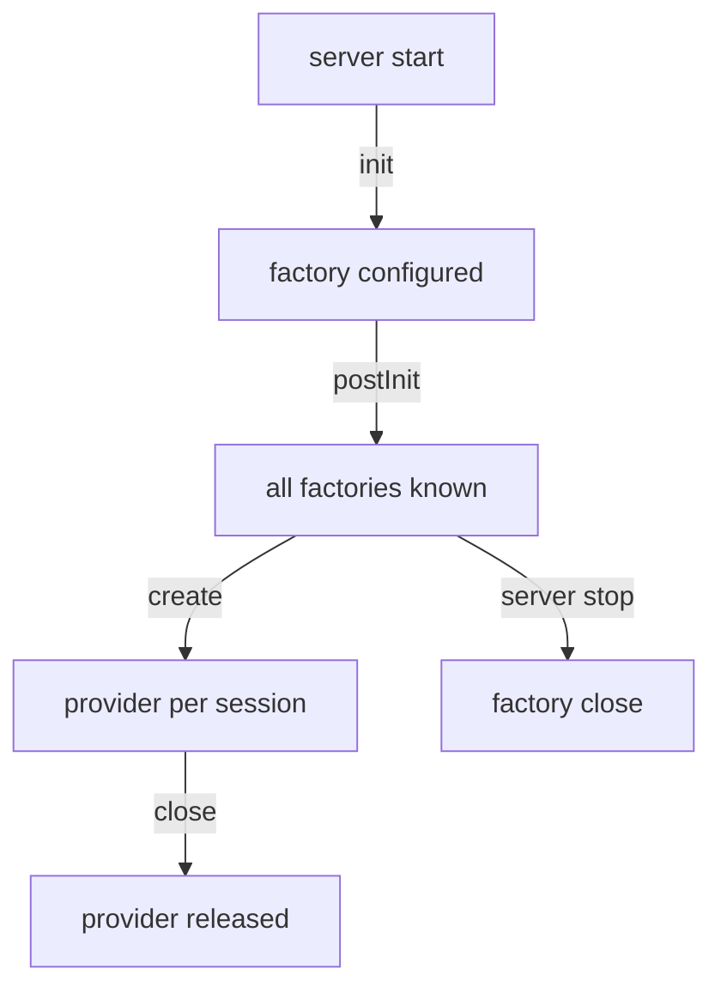

# Provider Lifecycle And KeycloakSession

A factory and a provider have different lifetimes, and many bugs come from mixing them up. A class that keeps a database connection in the wrong place, or reads its configuration too late, works in a test and fails under load. This part explains when Keycloak calls each method of a factory and a provider, and what a `KeycloakSession` gives them.

## The factory lives as long as the server

Keycloak creates one instance of each factory when it starts, and it keeps that instance until the server stops. It calls the factory's methods in a fixed order. `init(Config.Scope config)` runs once for every factory and receives the factory's configuration values. After every factory has run `init`, Keycloak calls `postInit(KeycloakSessionFactory factory)` on each of them once. `postInit` is the place to use other providers, because all factories are then known. `create(KeycloakSession session)` runs each time Keycloak needs a provider. `close()` runs once when the server shuts down.



The diagram shows that `init` and `postInit` run once per server start, while `create` and the provider's `close` run again and again, once per session.

Because the factory is shared by every request, it must not keep data that belongs to one request. Data that is the same for all requests, such as a configuration value read in `init`, belongs in a field of the factory.

## The provider lives as long as one session

A provider is created for a `KeycloakSession`. A session is the unit of work of one request: Keycloak opens it when a request arrives, and closes it when the request ends. The provider is created when the code first asks the session for it, and Keycloak calls the provider's `close()` when the session closes. A provider can therefore keep request data in its fields. It must release anything it opened, such as a stream, in `close()`.

## What a KeycloakSession gives you

The `KeycloakSession` is how provider code reaches the rest of Keycloak. The calls used in this course are these:

- `session.realms()` returns the provider that finds realms, for example `getRealm(id)` and `getRealmByName(name)`.
- `session.users()` returns the provider that finds users, for example `getUserByUsername(realm, name)`.
- `session.getContext()` returns the context of the current request, including the realm (`getRealm()`) and the client (`getClient()`) when the request has them.
- `session.getProvider(Class)` returns another provider by its interface, for example the provider that sends events.
- `session.getTransactionManager()` returns the transaction of the request. Changes made through the model classes are saved when the transaction commits.

The realm and user objects are models (`RealmModel`, `UserModel`). A change to a model, such as `user.setSingleAttribute("department", "warehouse")`, is written to the database when the request's transaction commits, not at the moment of the call.

## See the order in your own log

Add one log line to each method of the `inventory-status` factory, rebuild, and read the server log. Save this as the new content of the factory methods, using the same `Logger` pattern as in the event listener:

<!-- astrona:playground:renew -->

```java
private static final Logger LOG = Logger.getLogger(InventoryStatusProviderFactory.class);

@Override
public void init(Config.Scope config) {
    LOG.info("inventory-status factory init");
}

@Override
public void postInit(KeycloakSessionFactory factory) {
    LOG.info("inventory-status factory postInit");
}
```

After `upload_source` and `build_provider`, search the log of the new pod:

```sh
kubectl -n spi-demo logs deploy/keycloak | grep "inventory-status factory"
```

The log has one `init` line and one `postInit` line for each start of the server, in that order, and no new line for each request. Send a few requests to the endpoint and run the command again: the number of lines does not change, which shows that the factory is created once.

You now know that a factory is created once and a provider once per session, and that the session is the way to reach realms, users and other providers. The open question is how code outside Keycloak, such as a third-party library, gets into the JAR.

## Common pitfalls

> [!WARNING]
> - **Keeping request data in a factory field.** Every request shares the factory, so the data of one user leaks into another request.
> - **Using other providers in `init`.** Other factories may not be ready; use `postInit`.
> - **Not closing resources in the provider's `close()`.** The provider is closed for every session, so a leak grows with the traffic.
> - **Expecting a model change to be saved at once.** It is saved when the request's transaction commits.
