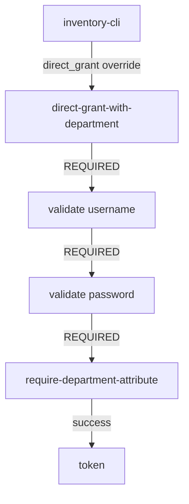

# Wiring An Authenticator Into A Flow

Keycloak has loaded `require-department-attribute`, and nothing has changed for any user. An authenticator only runs when a flow has an execution that uses it, and a flow only runs when a binding points at it. This part copies the direct grant flow, adds the department check, binds the copy to `inventory-cli`, and proves the rule with `alice` and `bob`.

## Copy the direct grant flow

Never change the built-in `direct grant` flow: every client in the realm uses it. Copy it instead. The copy gets its own alias and starts with the same three steps:

<!-- astrona:playground:renew -->

```sh
kcadm create "authentication/flows/direct%20grant/copy" -r inventory \
  -s newName=direct-grant-with-department
```

## Add the step and make it required

Add an execution that runs your authenticator. Keycloak appends it at the end of the flow's top level, so it runs after the username and password steps have found the user:

```sh
kcadm create authentication/flows/direct-grant-with-department/executions/execution -r inventory \
  -s provider=require-department-attribute
```

A new execution starts as `DISABLED`, which means it never runs, at the end of the flow's top level. Find its id and its priority, and set its requirement to `REQUIRED`:

```sh
EXECUTION_ID="$(kcadm get authentication/flows/direct-grant-with-department/executions -r inventory \
  --fields id,providerId --format csv --noquotes | awk -F, '$2=="require-department-attribute"{print $1}')"
EXECUTION_PRIORITY="$(kcadm get authentication/flows/direct-grant-with-department/executions -r inventory \
  --fields id,priority --format csv --noquotes | awk -F, -v id="$EXECUTION_ID" '$1==id{print $2}')"
kcadm update authentication/flows/direct-grant-with-department/executions -r inventory --no-merge \
  -b "{\"id\":\"$EXECUTION_ID\",\"requirement\":\"REQUIRED\",\"priority\":$EXECUTION_PRIORITY}"
```

`--no-merge` replaces the whole execution with the body you send. Keycloak orders the steps of a flow by their `priority`, so the body carries the step's current priority too. Without it, the priority drops to `0`, the step moves before the username and password steps, and every sign-in fails with `unknown_error`: the authenticator runs before Keycloak knows the user.

Read the flow again with `kcadm get authentication/flows/direct-grant-with-department/executions -r inventory --fields displayName,requirement`. The last step shows the display name of your authenticator, `Require Department Attribute`, with the requirement `REQUIRED`.



The diagram shows the order Keycloak runs for a password grant from `inventory-cli` once the override is in place: the two built-in checks, then your step, then the token.

## Bind the copy to one client

The flow exists, but nothing uses it yet. Bind it to `inventory-cli` only, through the client's flow override for the direct grant. The override takes the flow's id, not its alias:

```sh
FLOW_ID="$(kcadm get authentication/flows -r inventory --fields id,alias --format csv --noquotes \
  | awk -F, '$2=="direct-grant-with-department"{print $1}')"
CLIENT_ID="$(kcadm get clients -r inventory -q clientId=inventory-cli --fields id --format csv --noquotes)"
kcadm update "clients/$CLIENT_ID" -r inventory -s "authenticationFlowBindingOverrides.direct_grant=$FLOW_ID"
```

The realm's own binding stays `direct grant`, so every other client keeps the old sign-in.

## Prove the rule

Sign in as both users again:

```sh
get_user_token alice alice-password
get_user_token bob bob-password
```

`alice` still gets an access token: she has a department, so the step calls `success()`. `bob` now gets the error message from your authenticator instead of a token, because the step calls `failure()` with the `invalid_grant` body. Same client, same password check, different result, decided by one attribute.

The step is configurable as well. An administrator can point it at another attribute without a new build by adding a configuration to the execution, for example with `kcadm create "authentication/executions/$EXECUTION_ID/config" -r inventory -s alias=department-check -s 'config.attribute=cost-center'`. Without a configuration, the step uses its default, `department`.

You can now take an authenticator from loaded to enforced: copy a flow, add the execution, set it to `REQUIRED`, and bind the flow to one client. The open question is how fast you can do it, and prove it, on a cluster you did not set up.

## Common pitfalls

> [!WARNING]
> - **Leaving the new execution `DISABLED`.** A new execution is disabled until you change it, and a disabled step lets everyone through.
> - **Binding the override with the flow's alias.** `authenticationFlowBindingOverrides` takes the flow's id.
> - **Changing the realm's `directGrantFlow`.** That applies the rule to every client in the realm.
> - **Testing only the user who should pass.** Prove the refusal too, with a user who has a valid password and no department.

## Your mission: Require A Department For Password Sign-In

You can now wire a loaded authenticator into one client's sign-in and prove the rule with two users. The graded lab gives you Keycloak with `require-department-attribute` already built and loaded, and asks you to make `inventory-cli` refuse users without a department while every other client keeps the realm's default flow.

The lab runs in its own cluster, so first pause your playground. Nothing in it is lost:

```sh
astrona stop ats-092-playground-020-01
```

Then start the lab:

```sh
astrona run --git ssh://git@github.com/astrona-io/ATS092.git -c sections/section-020/module-01/labs/lab-01
```

The task is on the next page. Solve it on your own first. When you think you are done, send it for grading:

```sh
astrona submit -c sections/section-020/module-01/labs/lab-01
```

When the lab is done, remove it and start your playground again:

```sh
astrona destroy ats-092-lab-020-01
astrona start ats-092-playground-020-01
```
