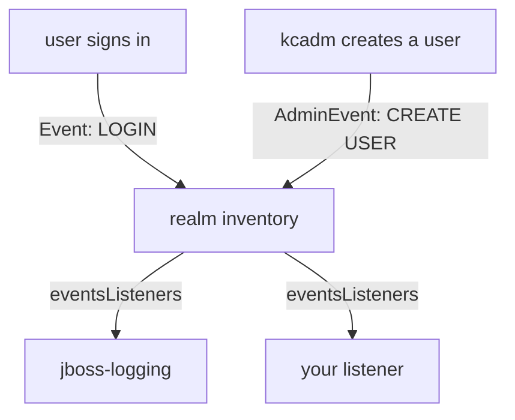

# User Events And Admin Events

You cannot write a useful listener without knowing what Keycloak sends to it. This part reads the realm's event configuration, triggers a successful and a failed sign-in, and finds out which of them the built-in listener writes to the server log. It also introduces admin events, the second kind of event a listener receives.

## The realm's event configuration

Every realm has an event configuration. It says which listeners receive the realm's events, whether Keycloak also **saves** user events and admin events in its database, and which event types it saves. Saving and listening are separate: a listener receives events even when the realm saves none.

Paste the helpers first. `kcadm` runs `kcadm.sh` in the Keycloak pod as the lab-only administrator. `get_user_token` signs a user in with the password grant through `inventory-cli` and prints the access token, or the error Keycloak returns.

<!-- astrona:playground:renew -->

```sh
NAMESPACE=events-demo

# kcadm runs kcadm.sh inside the Keycloak pod. It signs in to the realm
# master as the lab-only administrator on every call, so it keeps working
# after Keycloak restarts.
kcadm() {
  kubectl -n "$NAMESPACE" exec -i deploy/keycloak -- bash -c '
    /opt/keycloak/bin/kcadm.sh config credentials --server http://localhost:8080 \
      --realm master --user admin --password admin --config /tmp/kcadm.config >/dev/null &&
    /opt/keycloak/bin/kcadm.sh "$@" --config /tmp/kcadm.config' kcadm "$@"
}
```

```sh
# get_user_token USER PASSWORD: signs the user in through inventory-cli with
# the password grant and prints the access token, or the error. The password
# grant is used only to sign in from a terminal.
get_user_token() {
  kubectl -n "$NAMESPACE" exec deploy/tester -- sh -c '
    curl -s http://keycloak:8080/realms/inventory/protocol/openid-connect/token \
      -d grant_type=password -d client_id=inventory-cli \
      --data-urlencode username="$1" --data-urlencode password="$2" \
    | jq -r ".access_token // .error_description // .error"' sh "$1" "$2"
}
```

Read the event configuration of the realm `inventory`:

```sh
kcadm get events/config -r inventory
```

The field `eventsListeners` holds one name, `jboss-logging`, the built-in listener that every new realm uses. `eventsEnabled` and `adminEventsEnabled` are `false`: the realm saves no events in the database. The listener still receives every event.

## Which events reach the log

A user event has a **type**. The types you meet most often are these:

| Type | When Keycloak sends it |
| --- | --- |
| `LOGIN` | A user signed in, in a browser or with a token request such as the password grant |
| `LOGIN_ERROR` | A sign-in failed, for example with a wrong password |
| `CODE_TO_TOKEN` | A client exchanged an authorization code for tokens |
| `REFRESH_TOKEN` | A client used a refresh token to get new tokens |
| `LOGOUT` | A user session ended |
| `REGISTER` | A user created their own account on the registration page |

Sign `alice` in once with the right password and once with a wrong one, then read the last lines of the server log:

```sh
get_user_token alice alice-password
get_user_token alice wrong-password
kubectl -n events-demo logs deploy/keycloak --since=1m | grep -i 'type="LOGIN'
```

The first command prints a token, the second prints an error. The log has a `WARN` line from `jboss-logging` for the failed sign-in, with `type="LOGIN_ERROR"`, the realm, the client and the error `invalid_user_credentials`. It has no line for the successful sign-in. The `jboss-logging` listener writes successful events at the log level `debug` and errors at `warn`, and the server prints `info` and above. The successful `LOGIN` event happened; it just did not reach the log.

That is the security team's problem in one command: the events they want exist, but the built-in listener does not print them. A listener of your own decides for itself what to write and at which level.

## Admin events

The second kind of event comes from administration. An **admin event** records a change made through the Admin REST API, the HTTP API that both the Admin Console and `kcadm.sh` use. It has no type like `LOGIN`. Instead it has an **operation type** (`CREATE`, `UPDATE`, `DELETE` or `ACTION`), a **resource type** such as `USER`, `CLIENT` or `REALM`, and the **resource path**, for example `users/<id>`.

A listener receives the two kinds through two different methods, which you write in the next part: `onEvent(Event)` for user events and `onEvent(AdminEvent, boolean)` for admin events. The realm's setting `adminEventsEnabled` turns on saving admin events; this course turns it on whenever a listener needs admin events, so the realm records them and passes them on.



The diagram shows both kinds of event entering the realm, and the realm handing each one to every listener in its `eventsListeners` list.

You now know where a realm's listeners are set, which user events matter, why a successful sign-in does not appear in the log, and what an admin event holds. The open question is what a listener's code looks like, and how it chooses what to write.

## Common pitfalls

> [!WARNING]
> - **Mixing up saving and listening.** `eventsEnabled` saves events in the database; listeners receive events either way.
> - **Looking for successful sign-ins in the `jboss-logging` output.** They are written at `debug`, which the server does not print by default.
> - **Expecting admin changes among the user events.** Admin events are a separate kind, with operation and resource types instead of an event type.
> - **Using a wrong password to test a `LOGIN` listener.** A wrong password sends `LOGIN_ERROR`, not `LOGIN`.
