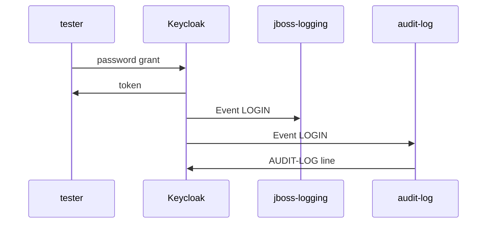

# Enabling A Listener In A Realm

Keycloak has loaded `audit-log`, and the realm `inventory` ignores it. A listener is loaded for the whole server, but each realm chooses which listeners receive its events. This part turns the listener on for one realm, keeps the built-in one next to it, proves it with a sign-in, and adds admin events.

## Add the listener next to jboss-logging

A realm's listeners are the list `eventsListeners` in its event configuration. Setting the list replaces it, so write every listener the realm should keep, not just the new one. The realm needs `jboss-logging` too: it is still the one that writes failed sign-ins as warnings.

<!-- astrona:playground:renew -->

```sh
kcadm update events/config -r inventory -s 'eventsListeners=["jboss-logging","audit-log"]'
kcadm get events/config -r inventory --fields eventsListeners
```

The list now holds both names. No restart is needed: this is realm data, not a new JAR, and Keycloak uses it from the next event on.

## Prove it with a sign-in

Sign `alice` in and read the log:

```sh
get_user_token alice alice-password
kubectl -n events-demo logs deploy/keycloak --since=1m | grep AUDIT-LOG
```

The log has the line `AUDIT-LOG type=LOGIN realm=inventory client=inventory-cli user=alice`, written at `info` by the category `io.astrona.keycloak.inventory.AuditLogEventListenerProvider`. Sign in once with a wrong password as well: `jboss-logging` writes its `LOGIN_ERROR` warning, and `audit-log` writes nothing, because it only handles `LOGIN`.



The diagram shows one sign-in: Keycloak answers the token request, then hands the `LOGIN` event to each listener in the realm's list, and `audit-log` writes its line.

## Add admin events

Admin events come from changes made through the Admin REST API. Turn on saving admin events and their details for the realm, so it records them and passes them to its listeners:

```sh
kcadm update events/config -r inventory -s adminEventsEnabled=true -s adminEventsDetailsEnabled=true
```

Now make an admin change, create a user, and read the log:

```sh
kcadm create users -r inventory -s username=carol -s enabled=true \
  -s email=carol@example.com -s firstName=Carol -s lastName=Example
kubectl -n events-demo logs deploy/keycloak --since=1m | grep 'AUDIT-LOG admin'
```

The log has a line that starts with `AUDIT-LOG admin operation=CREATE resourceType=USER realm=inventory` and ends with the new user's resource path, `users/` followed by her id. The change came from `kcadm.sh`, signed in to the realm `master`, but the event belongs to the realm `inventory`, because that is the realm the change was made in.

You can now turn a listener on for a realm without losing the built-in one, prove it with a real event, and receive admin changes as well. The open question is how quickly you can find why a listener stays silent on a cluster you did not set up.

## Common pitfalls

> [!WARNING]
> - **Setting `eventsListeners` to only your listener.** The list is replaced, not extended; `jboss-logging` disappears and failed sign-ins are no longer logged.
> - **Restarting Keycloak after changing the event configuration.** It is realm data; only a new JAR needs a restart.
> - **Expecting admin events in the realm `master`.** An admin event belongs to the realm that was changed, not to the realm the administrator signed in to.
> - **Testing with the wrong event.** A wrong password produces `LOGIN_ERROR`; test a `LOGIN` listener with a successful sign-in.

## Your mission: Log Every Login With A Custom Listener

You can now turn a listener on for a realm and prove it with a real sign-in. The graded lab gives you an `audit-log` listener that is built and loaded but writes nothing when a user signs in, and asks you to find out why, fix it, and make the realm use it next to `jboss-logging`.

The lab runs in its own cluster, so first pause your playground. Nothing in it is lost:

```sh
astrona stop ats-092-playground-030-01
```

Then start the lab:

```sh
astrona run --git ssh://git@github.com/astrona-io/ATS092.git -c sections/section-030/module-01/labs/lab-01
```

The task is on the next page. Solve it on your own first. When you think you are done, send it for grading:

```sh
astrona submit -c sections/section-030/module-01/labs/lab-01
```

When the lab is done, remove it and start your playground again:

```sh
astrona destroy ats-092-lab-030-01
astrona start ats-092-playground-030-01
```
