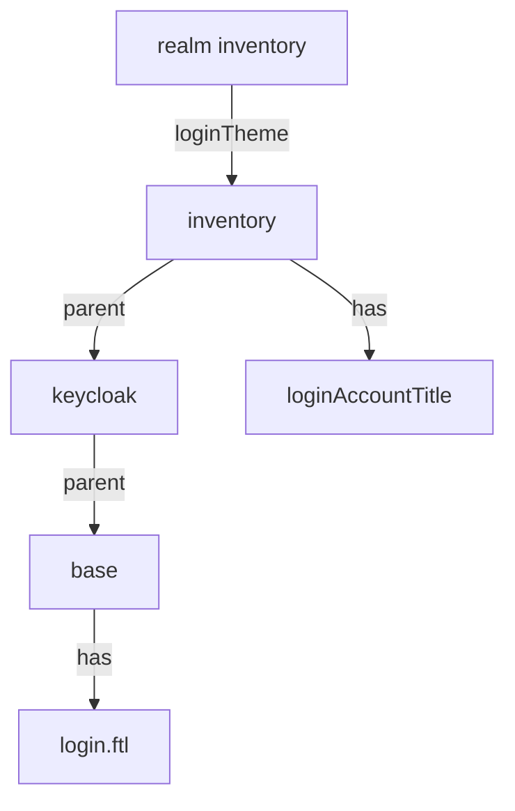

# Theme Types And How Keycloak Finds A Theme

Before you write a theme, you need to know which theme renders the page you want to change, and where Keycloak looks for each of its files. This part reads the themes Keycloak has, fetches the realm's login page, and explains the lookup through `parent` that lets a small theme change one line.

## Theme types and the built-in themes

A theme has a **type**, and the type decides which pages it renders:

| Type | Pages |
| --- | --- |
| `login` | The login form, registration, password reset, error pages, and the other pages of a sign-in |
| `account` | The account console, where users manage their own profile |
| `email` | The emails Keycloak sends, such as a password reset link |
| `admin` | The Admin Console |
| `welcome` | The welcome page at the server's root |

A realm selects a theme per type, for example with the settings `loginTheme` and `emailTheme`. A realm that selects nothing uses the server's default. Keycloak 26 ships the theme `base`, which holds the templates and messages without styling, and the themes `keycloak` and `keycloak.v2`, which build on top of it.

Paste the helpers first. `kcadm` runs `kcadm.sh` in the Keycloak pod as the lab-only administrator. `login_page_title` fetches the login page of the realm `inventory` from the `tester` pod, through the client `inventory-web`, and prints the heading text.

<!-- astrona:playground:renew -->

```sh
NAMESPACE=themes-demo

# kcadm runs kcadm.sh inside the Keycloak pod. It signs in to the realm
# master as the lab-only administrator on every call, so it keeps working
# after Keycloak restarts.
kcadm() {
  kubectl -n "$NAMESPACE" exec -i deploy/keycloak -- bash -c '
    /opt/keycloak/bin/kcadm.sh config credentials --server http://localhost:8080 \
      --realm master --user admin --password admin --config /tmp/kcadm.config >/dev/null &&
    /opt/keycloak/bin/kcadm.sh "$@" --config /tmp/kcadm.config' kcadm "$@"
}
```

```sh
# login_page_title: fetches the login page of the realm inventory from the
# tester pod, through the client inventory-web, and prints its heading.
login_page_title() {
  kubectl -n "$NAMESPACE" exec deploy/tester -- curl -s \
    'http://keycloak:8080/realms/inventory/protocol/openid-connect/auth?client_id=inventory-web&response_type=code&scope=openid&redirect_uri=http%3A%2F%2Flocalhost%2Fcallback' \
  | grep -o 'Sign in to[^<]*' | head -n 1
}
```

List the login themes Keycloak knows, and the realm's own choice:

```sh
kcadm get serverinfo | jq '.themes.login | map(.name)'
kcadm get realms/inventory --fields loginTheme
```

The list contains `base`, `keycloak` and `keycloak.v2`. The realm has no `loginTheme` set, so it uses the default. Now read the heading of its login page:

```sh
login_page_title
```

The heading is `Sign in to your account`. That text is not in a template. It is the value of the message key `loginAccountTitle`, which a template prints.

## Templates print messages

The login page comes from the FreeMarker template `login.ftl`, and the page heading comes from a line in it that prints `${msg("loginAccountTitle")}`. FreeMarker replaces that expression with the value of `loginAccountTitle` in the message file for the user's language, for example `messages/messages_en.properties` for English. The template decides **where** the text goes; the message file decides **what** it says.

That split is why a message override is the smallest change you can make. To change the heading, you do not copy `login.ftl`; you add one line to a message file of your own: `loginAccountTitle=Sign in to Inventory`.

## Inheritance through parent

A theme does not need every file. Its file `theme.properties` names a `parent`, and when Keycloak needs a file the theme does not have, it looks in the parent, then in the parent's parent, and so on. Messages are merged the same way: your message file only has to hold the keys you change.



The diagram shows the lookup for the login page: Keycloak takes `login.ftl` from `base` through the chain of parents, and the message `loginAccountTitle` from `inventory`, because the theme closest to the realm wins.

## Where themes come from

Keycloak finds themes in three places. The built-in themes live in a JAR inside the server. A **theme directory** lives at `/opt/keycloak/themes/<theme name>/<type>/`, for example `/opt/keycloak/themes/inventory/login/theme.properties`. And a JAR in the providers directory can hold themes too, listed in its file `META-INF/keycloak-themes.json`.

In development mode Keycloak does not cache themes and templates, so a change to a file in a theme directory shows on the next page load. In production it caches them, and you restart Keycloak or switch the caches off with `--spi-theme--cache-themes=false` and `--spi-theme--cache-templates=false` while you work on a theme.

You now know the theme types, the built-in themes, how a template prints a message, and how `parent` lets a theme hold only the files it changes. The open question is how to get your own theme into the Keycloak pod and make the realm use it.

## Common pitfalls

> [!WARNING]
> - **Copying `login.ftl` to change a text.** Override the message key instead; a copied template must be checked again on every Keycloak upgrade.
> - **Changing the built-in themes.** Write your own theme with a `parent`; files inside the server are replaced on upgrade.
> - **Setting the realm's theme before the theme exists.** Keycloak cannot render a theme it did not find.
> - **Expecting a production server to show a theme change at once.** Production caches themes; development mode does not.
